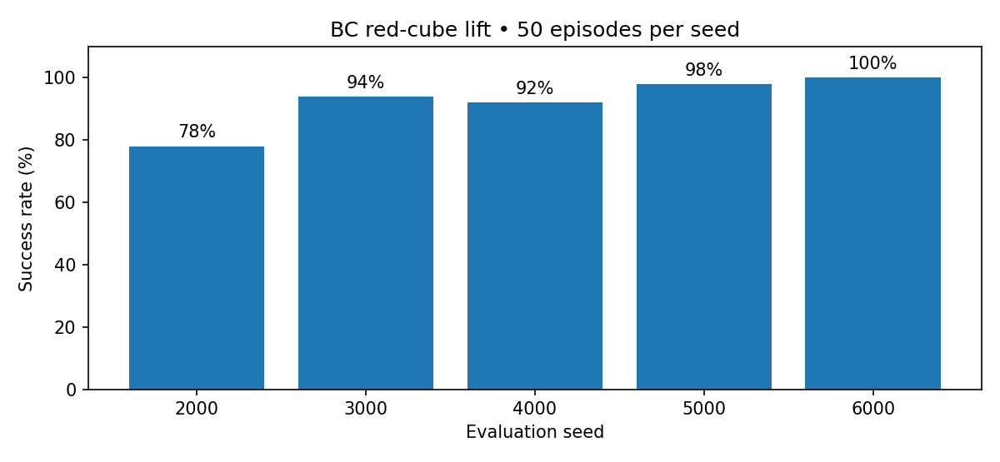
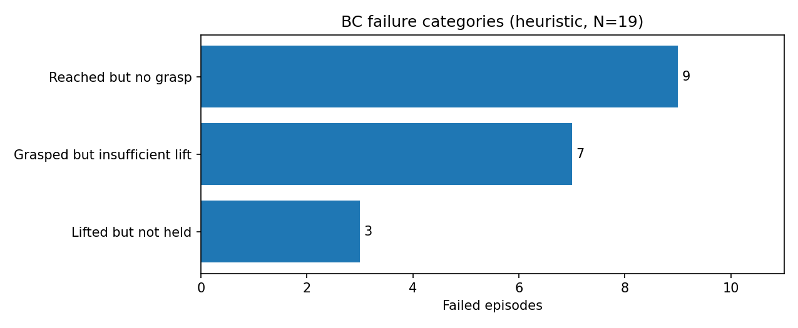

# robosuite-project

**Franka Panda | Three-cube tabletop manipulation | Scripted demonstrations → Behavioral Cloning → Multi-seed evaluation**

[](https://robosuite.ai/) [](https://robomimic.github.io/) [](https://www.python.org/) [](https://wandb.ai/muhamuttaqien/robosuite-project)

A reproducible robot manipulation baseline built with **robosuite / MuJoCo** and **robomimic**. A Franka Panda learns to grasp and lift the **red cube** while **blue and green cubes act as distractors**. Robot initial joint configuration and all three cube positions are randomized each episode. The first algorithm is **low-dimensional deterministic Behavioral Cloning (BC)**; ACT and Diffusion Policy are potential future comparisons, **not yet implemented**.

> **Important:** The BC policy receives simulated ground-truth cube positions and robot proprioception. The videos below visualize execution; RGB images are **not** policy inputs. These results should not be interpreted as vision-based manipulation.

## BC evaluation results

**92.4% success: 231 / 250 episodes** across five batches of 50 held-out randomized episodes. Mean seed success **92.4% ± 8.65 percentage points**, where ± denotes the **sample standard deviation of five per-seed rates** (not a confidence interval).



| Evaluation seed | Successful / total | Success rate |
|:---|---:|---:|
| 2000 | 39 / 50 | 78% |
| 3000 | 47 / 50 | 94% |
| 4000 | 46 / 50 | 92% |
| 5000 | 49 / 50 | 98% |
| 6000 | 50 / 50 | 100% |
| **Overall** | **231 / 250** | **92.4%** |

The scripted expert completed **100/100 demonstration-collection attempts**, which is *not* a matched-seed expert-vs-BC comparison. The BC model was trained with **90 demonstration trajectories**, with **10 reserved for validation** (100 collected total). Evaluation results refer to the **200-epoch BC checkpoint**, control frequency 20 Hz, and red-cube lift-and-hold criterion.

### Successful and failed rollouts

[**Watch success and failure videos on W&B**](https://wandb.ai/muhamuttaqien/robosuite-project/runs/atyi069p) · [**View the experiment dashboard**](https://wandb.ai/muhamuttaqien/robosuite-project)

For GitHub-inline previews, run `python scripts/make_readme_gifs.py --videos-dir results/bc_eval_multiseed_media/videos` after generating evaluation MP4s and commit the resulting small GIFs in `assets/`. GitHub READMEs cannot reliably embed playable MP4 files inline, so GIF previews are used here.

<!-- PREVIEW_START -->
**Success examples**


**Failure examples**


<!-- PREVIEW_END -->

*The provided project archive did not contain the locally generated `.mp4` files, so they are linked from the verified W&B evaluation run rather than represented by invented GIFs. After you generate previews, the preview generator replaces this block with images.*

### Failure analysis



| Heuristic category | Failed episodes | % of failures |
|---|---:|---:|
| Reached red cube, no grasp detected | 9 | 47.4% |
| Grasp detected, lift below threshold | 7 | 36.8% |
| Lift achieved but not held long enough | 3 | 15.8% |
| **Total failures** | **19** | **100%** |

Failure labels are **post-hoc heuristics**, not verified root causes. Inspect episode video before drawing causal conclusions. The success predicate requires red cube ≥ **0.10 m** above its initial height **while grasped for 10 consecutive control steps**.

## Repository structure

```text
robosuite-project/
├── control_franka.py                   # Keyboard teleoperation
├── scripts/
│   ├── collect_demos.py                # Three-cube environment and scripted expert
│   ├── train_bc.py                      # robomimic low-dimensional BC training
│   ├── evaluate_bc.py                   # Multi-seed evaluation, W&B, failure analysis, MP4
│   └── make_readme_gifs.py              # Optional GitHub-ready video previews
├── assets/
│   ├── success_by_seed.png
│   └── failure_categories.png
├── results/                             # Small supplied CSV/JSON evaluation records
├── requirements.txt
├── .gitignore
└── README.md
```

## Installation

Tested project configuration: **Python 3.11**, **robosuite 1.5.2**, **MuJoCo 3.3.0**, and **robomimic v0.5.0**. You need a Linux desktop or configured offscreen MuJoCo renderer; NVIDIA GPU is recommended for training.

```bash
git clone https://github.com/muhamuttaqien/robosuite-project.git
cd robosuite-project
python3.11 -m venv .venv
source .venv/bin/activate
python -m pip install --upgrade pip
python -m pip install -r requirements.txt
```

PyTorch/CUDA dependencies can require multiple gigabytes. To collect scripted demonstrations only, install the simulation/data packages first, then install the full requirements for BC training.

## Step 1 — Collect expert demonstrations

```bash
python scripts/collect_demos.py \
  --num-demos 100 --max-attempts 600 \
  --output datasets/red_cube_lift/expert_demos_100.hdf5
```

The scripted expert approaches, descends toward, grasps, and lifts the red cube. Only verified successful trajectories are written to HDF5. Failed attempts are not part of the BC demonstration dataset.

Create a 90/10 trajectory-level split:

```bash
python -m robomimic.scripts.split_train_val \
  --dataset datasets/red_cube_lift/expert_demos_100.hdf5 --ratio 0.1
```

## Step 2 — Train Behavioral Cloning

```bash
python -m wandb login
python scripts/train_bc.py \
  --dataset datasets/red_cube_lift/expert_demos_100.hdf5 \
  --epochs 200 --batch-size 64 \
  --wandb --wandb-project robosuite-project
```

The model predicts a **7D end-effector/gripper control action** from robot joint positions/velocities, end-effector pose, gripper state, and all three cube positions. BC uses `seq_length=1`, deterministic MLP actor, and no rollout-based optimization.

With robomimic's native W&B logging, configure `WANDB_ENTITY` in the installed `robomimic/macros_private.py` if the library reports that it is `None`. Set it to your W&B username/team (e.g. `muhamuttaqien`). Training saves checkpoints under `checkpoints/red_cube_bc/`.

## Step 3 — Evaluate and publish media to W&B

Replace `PATH/TO/model_epoch_200.pth` with your actual checkpoint path:

```bash
python scripts/evaluate_bc.py \
  --checkpoint PATH/TO/model_epoch_200.pth \
  --episodes 50 \
  --seeds 2000 3000 4000 5000 6000 \
  --output results/bc_eval_multiseed.json \
  --save-videos --videos-per-outcome 3 \
  --wandb --wandb-project robosuite-project \
  --run-name bc-red-cube-eval
```

Outputs include aggregate and per-seed `.json`/`.csv`, `*_analysis_failures.json`, `*_analysis_failures.md`, success/failure charts, and **up to 3 success + 3 failure MP4 clips** (available when those outcomes occur). W&B receives scalar metrics, per-episode table, images, and sample videos. The evaluator computes overall success rate, mean seed success rate, and sample SD across seed rates (single-seed SD is undefined).

### Generate GIFs for the GitHub README

```bash
python scripts/make_readme_gifs.py \
  --videos-dir results/bc_eval_multiseed_media/videos

git add README.md assets/
git commit -m "Document BC baseline and add rollout previews"
git push origin main
```

GIFs are deliberately resized and frame-subsampled for a manageable GitHub page; raw MP4 outputs and large HDF5/checkpoints are ignored by Git and can remain in W&B/local storage.

## Reproducibility and limitations

- Results are on **randomized held-out seeds from the same task distribution**, not tested out-of-distribution robustness.
- Training/validation split is by **trajectory**, not by individual timesteps.
- The displayed SD is **between seed-batch rates**; it is not the uncertainty of the overall 92.4% statistic.
- Colors are not visually inferred by the policy; positions are privileged simulator observations.
- BC performance has not yet been compared with ACT or Diffusion Policy on this benchmark.
- Generated HDF5 data, checkpoints, W&B run files, and raw evaluation MP4 clips are excluded from version control by default.

## Experiment dashboard

- [W&B project — `robosuite-project`](https://wandb.ai/muhamuttaqien/robosuite-project)
- [BC multi-seed evaluation — 231/250](https://wandb.ai/muhamuttaqien/robosuite-project/runs/atyi069p)
