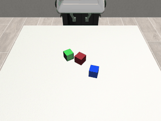
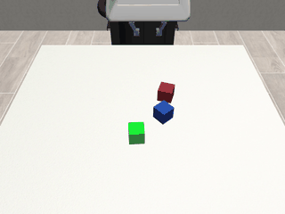
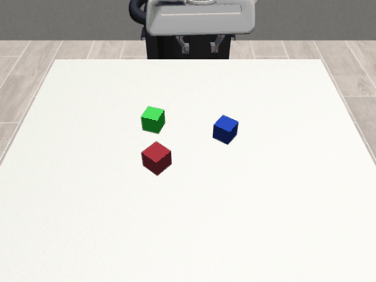
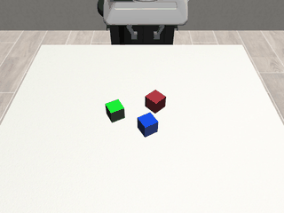
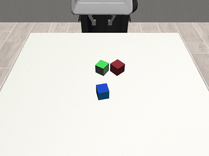
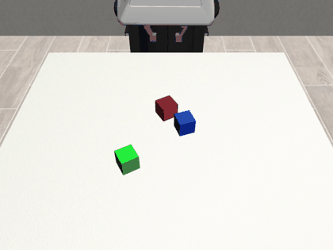

# Robosuite Project

Robotic manipulation experiments using **robosuite**, **robomimic**, and the **Franka Panda** robot in MuJoCo. This project investigates imitation learning for robotic manipulation, starting with **Behavioral Cloning (BC)** and extending toward ACT and Diffusion Policy.

## Task Overview

The environment contains three cubes: red, blue, and green. The robot must grasp and lift the **red cube**, while the other two act as distractors.

Both the robot's initial arm configuration and the cube positions are randomized across episodes.

## Behavioral Cloning (BC)

The BC policy is trained using successful trajectories collected by a scripted expert.

| Configuration | Value |
|---|---|
| Robot | Franka Panda |
| Algorithm | BC (MLP) |
| Demonstrations | 100 |
| Training | 200 epochs |
| Control | 7D OSC_POSE |
| Observations | Low-dimensional robot and cube states |
| Evaluation | 5 seeds × 50 episodes |

### Evaluation Results

| Metric | Result |
|---|---|
| Success Rate | **92.4% (231/250)** |
| Mean ± SD across seeds | **92.4% ± 8.65 pp** |
| Failed Episodes | 19 |

Failure breakdown: 9 grasp failures, 7 insufficient-lift failures, and 3 insufficient-hold failures (heuristic classifications).

[View full evaluation results on W&B](https://wandb.ai/muhamuttaqien/robosuite-project/runs/atyi069p)

### Successful Rollouts

<table>
  <tr>
    <td></td>
    <td></td>
  </tr>
  <tr>
    <td></td>
    <td></td>
  </tr>
</table>

### Failed Rollouts

<table>
  <tr>
    <td></td>
    <td></td>
  </tr>
</table>

## Installation

```bash
git clone https://github.com/muhamuttaqien/robosuite-project.git
cd robosuite-project

python3.11 -m venv .venv
source .venv/bin/activate
pip install -r requirements.txt
```

## Usage

**1. Collect expert demonstrations**

```bash
python scripts/collect_demos.py \
    --num-demos 100 \
    --max-attempts 600 \
    --output datasets/red_cube_lift/expert_demos_100.hdf5
```

**2. Train BC**

```bash
python scripts/train_bc.py \
    --dataset datasets/red_cube_lift/expert_demos_100.hdf5 \
    --epochs 200 \
    --batch-size 64
```

**3. Evaluate BC**

```bash
python scripts/evaluate_bc.py \
    --checkpoint checkpoints/red_cube_bc/<run>/models/model_epoch_200.pth \
    --episodes 50 \
    --seeds 2000 3000 4000 5000 6000 \
    --save-videos \
    --wandb \
    --wandb-project robosuite-project
```

## Future Work

- Action Chunking Transformer (ACT)
- Diffusion Policy
- World Model-guided manipulation

